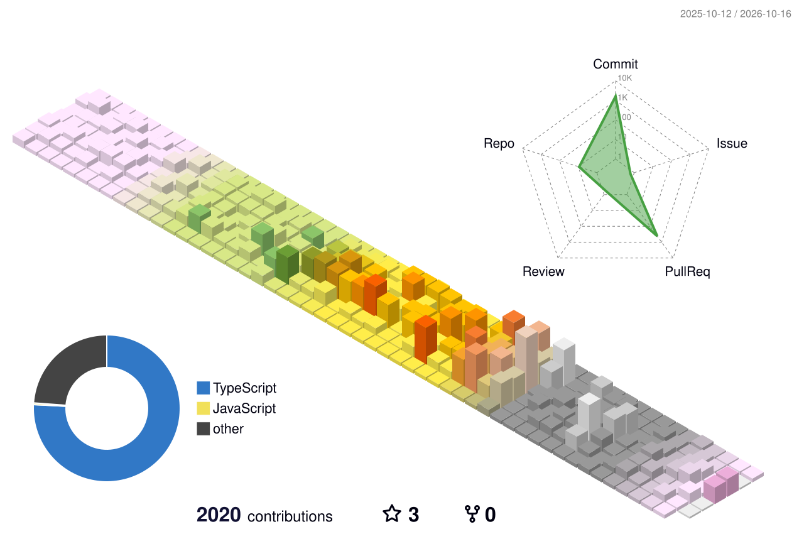

# Hi, I'm Byoungyoon 👋

> **화면을 넘어, 서비스의 문제를 해결하는 프론트엔드 엔지니어**

React·Next.js·TypeScript를 기반으로 교육 플랫폼과 모바일 서비스를 개발해 온 **5년 차 프론트엔드 개발자**입니다.

복잡한 업무 흐름을 사용하기 쉬운 인터페이스로 만들고, 필요한 경우 데이터 구조 개선부터 업무 자동화, 배포·운영까지 문제 해결 범위를 넓혀 왔습니다.

**구조는 변경하기 쉽게, 기능은 실제로 쓰이게 만드는 것**을 중요하게 생각합니다.
AI와 적극적으로 협업하되, 설계의 이유를 설명하고 결과의 품질을 판단하는 일은 직접 책임집니다.

 

## 🚀 Selected Experience

### 문제은행 — 데이터 구조 개선을 업무 자동화로

시험지 등록·편집·미리보기·출력까지 이어지는 사용자 흐름을 개발하고,
수식 렌더링·인쇄 레이아웃·대용량 문항 데이터 처리 과정의 문제를 개선했습니다.

기존 문항 데이터를 **JSON 기반으로 마이그레이션**하고,
강사의 오류 접수 시 해당 문항을 검수하는 자동화 봇을 구현했습니다.
봇이 반복되는 오류 패턴을 분석하고 파서 로직까지 수정하도록 하여,
개별 오류 처리를 공통 처리 로직 개선으로 연결했습니다.

**오류 접수 → 자동 검수 → 반복 패턴 분석 → 파서 수정**

이와 병행하여 **OCR 기반 시험지 문항 자동 추출 프로그램**을 개발하고 타 부서 업무에 적용했습니다.
조교들이 수행하던 수작업 타이핑 비용을 줄이고, 담당자의 반복 작업과 자료 처리 부담을 개선했습니다.

### TeamSystem — 학원 운영 서비스 개발과 공통 구조 개선

학생·수강·출결 관리부터 수납·환불·분할결제·정산까지,
학원 운영에 필요한 기능과 데이터 흐름을 개발했습니다.

단일 애플리케이션을 **4개 서비스 앱과 공용 패키지로 구성된 모노레포**로 전환하고,
인증·토큰 갱신·접근 권한·API·UI의 공통 구조를 정비했습니다.
Docker·Nginx 기반 빌드·배포 환경을 구성하고, 캐싱과 모니터링을 적용해 운영 이슈에 대응했습니다.

수학 콘텐츠 렌더링 기능은 **`psedu-math` 공통 라이브러리**로 분리하여,
여러 서비스에서 재사용할 수 있는 패키지 빌드·배포 구조를 마련했습니다.

 

## 📱 Side Projects

### 연OX — 모바일 커뮤니티 앱 · 관리자 웹

**React Native · Expo · Next.js · Supabase**

게시글과 O/X 투표로 의견을 나누는 모바일 앱과 관리자 웹을 개발했습니다.
데이터 모델 설계부터 소셜 로그인·알림·이미지 업로드·관리자 API까지,
사용자 기능과 운영 기능을 함께 구현했습니다.

Supabase Edge Function을 연동해 **게시글 품질 검수와 투표 선택지 추천** 기능을 개발하고,
네트워크 실패 시 로컬 규칙 기반 대체 로직으로 처리하도록 구성했습니다.

### 쏙 — 링크 아카이빙 · 협업 앱

**React Native · Next.js · Firebase · Firestore**

링크를 폴더·카테고리·태그로 정리하고, 공유 폴더에서 함께 관리하는 앱을 개발했습니다.

모바일 앱과 Next.js 공유 웹 페이지를 연결해,
앱을 설치하지 않은 사용자도 공유된 정보를 확인할 수 있도록 구성했습니다.
두 환경에서 동일한 데이터 모델을 활용하고, 딥링크로 웹에서 앱으로 이어지는 진입 흐름을 구현했습니다.

 

## 🤖 How I Work with AI

**AI에 작업을 나누어 맡기고, 결과는 직접 통합하고 검증합니다.**

Git Worktree로 기능별 작업 공간을 분리하고,
Codex와 Gemini에 구현·검증·UI 리뷰 역할을 나누어 병렬 개발을 수행합니다.

작업을 맡기기 전에는 요구사항과 기존 구조, 타입·상태 관리의 제약을 명확하게 전달합니다.
작업 이후에는 구현 결과가 서비스의 흐름에 맞는지 확인하고,
API 연동·예외 처리·사용자 경험을 검토한 뒤 통합합니다.

단순히 코드를 빠르게 생성하는 것보다,
**작업을 적절히 나누고 결과를 판단할 수 있는 개발 방식**을 만드는 데 집중하고 있습니다.

 

## 🛠️ Tech Stack

| 영역 | 활용 기술 |
| --- | --- |
| **Frontend** | React, Next.js, TypeScript |
| **State & Data Fetching** | TanStack Query, Zustand |
| **UI & Styling** | Vanilla Extract, Tailwind CSS, Storybook |
| **Mobile** | React Native, Expo, Flutter WebView 연동 |
| **Server & Data** | Next.js 서버 API, Supabase, Firebase, Firestore, IndexedDB |
| **Build & Operations** | pnpm, Turborepo, Docker, Nginx, Sentry |

 

## 🎯 What I'm Focusing On

AI를 개발 도구나 내부 자동화 수단으로 활용하는 것을 넘어,
**AI 자체가 사용자에게 가치를 제공하고 실제 매출로 이어지는 제품**에 관심이 있습니다.

프론트엔드 역량을 기반으로 서버·AI 연동까지 이해를 넓히고,
기능의 구현부터 운영과 개선까지 연결하는 개발자로 성장하고자 합니다.

새로운 기술을 적용했다는 사실보다,
**사용자가 계속 선택할 이유를 만들었는지**를 중요하게 생각합니다.

 

  

 

## 📫 Contact

편하게 연락 주세요! ☕️

- 📧 **Email:** bur5698@gmail.com
- 📞 **Phone:** 010-5024-1910
